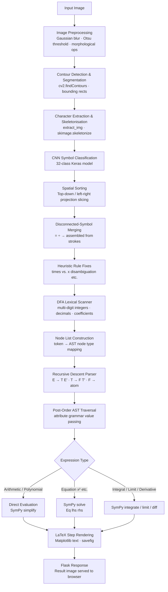

# Math OCR

**Handwritten Mathematical Expression Recognition, Parsing & Symbolic Solving**

A Python system that takes a photograph of a handwritten mathematical expression and produces a symbolic result — combining computer vision, a trained convolutional neural network, compiler-theory parsing, and a symbolic mathematics engine into a single pipeline.

---

## 📌 Overview

Recognising handwritten mathematics is harder than general OCR because mathematical notation is **two-dimensional**: superscripts, fractions, square roots, and integral limits do not follow a simple left-to-right reading order. A conventional text OCR engine cannot reconstruct these structures.

Math OCR addresses that challenge end-to-end:

1. **Segment** the image into individual character regions using OpenCV contour detection.
2. **Classify** each character with a trained CNN (32 symbol classes).
3. **Reconstruct** the 2-D spatial structure — superscripts, subscripts, fraction bars — using geometric relationship analysis.
4. **Scan** the reconstructed sequence through a Deterministic Finite Automaton to produce a flat token stream.
5. **Parse** the token stream with a recursive-descent parser into an Abstract Syntax Tree (AST).
6. **Evaluate or solve** the AST using SymPy's symbolic mathematics engine.
7. **Render** the step-by-step solution as a LaTeX-annotated image via Matplotlib.
8. **Serve** the full pipeline through a Flask web interface.

---

## ✨ Key Features

- **Image binarisation and noise reduction** — Gaussian blur, morphological opening/dilation, and Otsu's adaptive thresholding via OpenCV
- **Contour-based character segmentation** — each connected component becomes a candidate character region
- **Skeletonisation** — characters are thinned to a single-pixel skeleton before classification for style invariance
- **CNN symbol classifier** — two convolutional blocks + fully connected head trained on the CHROME dataset; 32 output classes
- **Spatial relationship analysis** — bounding-box geometry determines right, superscript, subscript, up, down, left, and including relationships between symbols
- **Disconnected-symbol merging** — symbols with multiple visual strokes (÷, =, →) are detected and merged by re-running the classifier on combined bounding regions
- **DFA lexical scanner** — groups raw characters into typed tokens (integer constant, decimal, variable, operator, function, reserved)
- **Recursive-descent parser** — LL(1) grammar over E / T / F productions builds a full AST
- **SymPy symbolic evaluation** — arithmetic, fractions, powers, roots, trigonometric functions, logarithms, limits, definite integrals, derivatives, and quadratic equations
- **Step-by-step rendering** — intermediate simplification steps are serialised to LaTeX strings and drawn onto a Matplotlib figure
- **Flask web application** — upload an image, receive the rendered solution in the browser

---

## 🏗️ System Architecture



---

## 🔄 End-to-End Processing Pipeline

### 1. Image Preprocessing & Segmentation

**File:** `tools/img_preprocess.py`

| Step | Operation | API |
|---|---|---|
| Resize | Scale by `SCALSIZE` factor (default 1×) | `cv2.resize` |
| Blur | 5×5 Gaussian blur | `cv2.GaussianBlur` |
| Greyscale | BGR → greyscale | `cv2.cvtColor` |
| Opening | 3×3 morphological open to smooth edges | `cv2.morphologyEx` |
| Dilation | 1 iteration to close small gaps | `cv2.dilate` |
| Blur again | 13×13 Gaussian blur before thresholding | `cv2.GaussianBlur` |
| Binarise | Otsu's method, inverted (foreground = 1) | `cv2.threshold(THRESH_BINARY_INV + THRESH_OTSU)` |

Connected components are found with `cv2.findContours(RETR_EXTERNAL)`. Regions with area < 100 px² are discarded as noise. Each surviving region is cropped, letterbox-scaled to a 45 × 45 canvas, skeletonised with `skimage.morphology.skeletonize`, and logically inverted to match the training data convention.

### 2. Spatial Sorting & Relationship Analysis

**File:** `tools/__init__.py`

Before classification, the character list is ordered top-to-bottom then left-to-right using **recursive projection slicing** (`sort_characters`):

1. Compute the 1-D projection of all bounding boxes along the current axis (vertical first).
2. If the projection reveals disjoint intervals, split the list at those boundaries.
3. Recurse on each split with the alternate axis (horizontal).
4. When no split is possible, preserve the current ordering.

**Spatial relationship classification** (`get_spatial_relationship`) maps any two bounding boxes to one of eleven categories using centre-point angle, height ratio (HR), and relative horizontal distance ratio (DR):

```
including · included · right · left · up · down
superscript · subscript · left_up · left_down · unknown
```

### 3. Disconnected-Symbol Merging

**File:** `process/__init__.py` — `detect_uncontinous_symbols`

Some symbols (`=`, `÷`, `→`) consist of multiple strokes that contour detection separates. The heuristic:

1. Groups of 2–3 vertically-overlapping regions are combined into one candidate bounding box.
2. The CNN classifies the merged region.
3. If the top prediction is a known disconnected symbol with probability > 0.5 and the sub-character composition matches the expected structure (e.g. `÷` requires a dash component flanked by non-digit strokes), the group is replaced by a single merged entry.

### 4. Heuristic Post-classification Fixes

**File:** `tools/__init__.py` — `modify_characters`

Context-resolvable CNN errors are corrected before parsing:

- `×` between two operators → relabelled as `x` (variable)
- `×` following a non-operand character → relabelled as `x`
- `,` not in superscript position → relabelled as `1` (frequent misclassification)
- `pi` immediately following `lim` → relabelled as `x`
- `lim` ensures the next character is `x` (the limit variable)

### 5. DFA Lexical Scanner

**File:** `scan/__init__.py`

A Deterministic Finite Automaton converts the ordered character list into typed tokens:

| State | Meaning |
|---|---|
| `START` | Beginning of a new token |
| `INCONSTANT` | Accumulating digit characters |
| `INDECIMAL` | Accumulating digits after a decimal point |
| `INVARIABLE` | Variable with numeric coefficient (e.g. `2x`) |
| `INRESERVE` | Reserved constant with numeric coefficient (e.g. `2π`) |
| `DONE` | Token complete |

Multi-digit integers, decimal numbers, and coefficient-variable pairs are assembled in a single pass. A `-` symbol appearing directly below existing text (detected via `get_spatial_relationship`) is classified as a **fraction bar** `f` rather than a subtraction operator.

Token types produced: `CONSTANT_INTEGER`, `CONSTANT_DECIMAL`, `VARIABLE`, `OPERATOR`, `FUNCTION`, `RESERVE`, `SPECIAL`, `CMP`, `END`.

---

## 🧠 CNN Model Architecture

**File:** `tools/cnn_model.py`

| # | Layer | Configuration |
|---|---|---|
| 1 | `Conv2D` | 32 filters, 3×3 kernel, ReLU, same padding, input `(45, 45, 1)` |
| 2 | `MaxPooling2D` | 3×3 pool, stride 3 |
| 3 | `Conv2D` | 64 filters, 3×3 kernel, ReLU, same padding |
| 4 | `MaxPooling2D` | 3×3 pool, stride 3 |
| 5 | `Flatten` | — |
| 6 | `Dense` | 1024 units, ReLU |
| 7 | `Dropout` | rate = 0.4 |
| 8 | `Dense` | 32 units, Softmax (one per symbol class) |

**Input:** 45 × 45 greyscale image, pixel values in `[0, 255]` as `float32`.  
**Output:** Probability distribution over 32 symbol classes.

**Recognised symbol classes** (`FILELIST` in `config/__init__.py`):

```
0 1 2 3 4 5 6 7 8 9
+ - × ÷ = ( )
x d e pi
sin cos tan log lim sqrt int
, . infty → point
```

**Inference checkpoint** — the repository includes the final trained checkpoint at step 16000:

```
my_cnn_model_config5/
├── checkpoint
├── graph.pbtxt
├── model.ckpt-16000.data-00000-of-00001   (~6.4 MB)
├── model.ckpt-16000.index
└── model.ckpt-16000.meta
```

Intermediate checkpoints (steps 8000, 12000) and TensorBoard event logs are excluded via `.gitignore`. The training dataset (`dataset1/`) is also excluded from version control — retained locally only. It contained CHROME dataset images organised by symbol class.

---

## 🛠️ Tech Stack

| Area | Technology |
|---|---|
| Language | Python 3 |
| Computer Vision | OpenCV (`cv2`) |
| Deep Learning | TensorFlow / Keras |
| Image Processing | scikit-image (`skimage.morphology`) |
| Symbolic Mathematics | SymPy |
| Web Framework | Flask + Werkzeug |
| Numerical Computing | NumPy |
| Visualisation | Matplotlib |

---

## 📁 Project Structure

```
math-ocr/
│
├── calculator/               # AST post-order evaluation; SymPy-based solving
│   └── __init__.py
│
├── config/                   # Global constants: symbol lists, DFA states,
│   └── __init__.py           #   node types, spatial relationships, paths
│
├── evaluator/                # Batch accuracy evaluation against labelled test set
│   └── __init__.py
│
├── my_cnn_model_config5/     # Final trained CNN checkpoint (step 16000)
│   ├── checkpoint
│   ├── graph.pbtxt
│   └── model.ckpt-16000.*
│
├── my_parser/                # Recursive-descent LL(1) parser; AST construction
│   └── __init__.py
│
├── process/                  # Disconnected-symbol merging; token grouping
│   └── __init__.py
│
├── scan/                     # DFA lexical scanner; token type assignment
│   └── __init__.py
│
├── solver/                   # Pipeline orchestrator: image → rendered result
│   └── __init__.py
│
├── static/                   # Flask static assets
│   ├── background.png        # Web UI background
│   ├── logo.png              # Web UI logo
│   ├── style.css             # Stylesheet
│   ├── script.js             # Frontend script
│   └── jquery-1.7.1.min.js  # jQuery
│
├── testImgs/                 # Sample handwritten equation images for evaluation
│   ├── easy +/
│   ├── easy -/
│   ├── easy div/
│   └── easy times/
│
├── tools/                    # Core utilities
│   ├── __init__.py           #   Spatial analysis, sorting, candidate selection
│   ├── cnn_model.py          #   Keras model definition; train/eval wrappers
│   ├── image_input.py        #   Dataset loader for training/evaluation
│   ├── img_preprocess.py     #   OpenCV preprocessing; segmentation; skeletonisation
│   └── train_and_eval_model.py  # Standalone training/evaluation script
│
├── main.py                   # CLI debug runner with verbose intermediate output
├── welcome.py                # Flask web application entry point
├── .gitignore
└── README.md
```
---

## 🚀 Getting Started

### Installation

```bash
git clone https://github.com/QuirkyNerd/math-ocr.git
cd math-ocr
pip install tensorflow flask werkzeug opencv-python scikit-image sympy numpy matplotlib
```

---

## ▶️ Running the Application

### Web Interface (primary)

```bash
python welcome.py
```

Flask serves the application at `http://127.0.0.1:5000`.

### CLI Debug Mode

```bash
python main.py
```

`main.py` runs a single hardcoded test image (`testImgs/easy +/3.jpg`) and prints detailed intermediate results — sorted character list, predicted tokens, parse tree, and LaTeX output — to stdout. It saves the result image to `result/1.jpg`. Useful for debugging individual pipeline stages.

---

## Usage

1. Start the application with `python welcome.py`.
2. Open `http://127.0.0.1:5000` in a browser.
3. Click **Choose File** and select a clear photograph or scan of a handwritten mathematical expression.
4. Click **Upload**.
5. The browser displays the uploaded image alongside the rendered result image, showing the recognised expression, intermediate simplification steps, and the final answer.

**Accepted formats:** `.png`, `.jpg`, `.jpeg`, `.gif`  
**Maximum upload size:** 16 MB

---

## Recognition & Parsing Design

Math OCR is distinguished from a simple image classifier by the combination of four domains:

```
Computer Vision   →   Deep Learning   →   Compiler Theory   →   Symbolic Mathematics
    (OpenCV)           (CNN / Keras)      (DFA + LL1 Parser)        (SymPy)
```

**Why each layer is necessary:**

- **Computer Vision** isolates individual symbols from arbitrary handwritten images and normalises them to a fixed representation. Without this, the CNN has no coherent inputs.

- **CNN classification** maps each isolated 45 × 45 character image to one of 32 mathematical symbols, handling handwriting style variation far better than template matching.

- **Spatial analysis** re-assembles the flat list of classified symbols into the correct 2-D mathematical structure. A symbol classified as `-` might be subtraction, negation, or a fraction bar — the spatial context decides which. Superscripts become exponents; spatially lower characters become subscripts for limits and integrals.

- **DFA scanning** converts the spatially-ordered character sequence into a typed token stream, handling multi-digit integers, decimal numbers, and implicit coefficient notation (e.g. `3x`) that no single character classification step can produce.

- **Recursive-descent parsing** enforces operator precedence and associativity through the grammar, producing an unambiguous AST. Expressions like `2 + 3 × 4` correctly evaluate to 14, not 20.

- **SymPy evaluation** provides exact symbolic results — integer fractions remain as fractions (`7/12`), square roots of non-perfect-squares remain symbolic (`√2/2`), and equations produce exact root sets. The same AST traversal generates the step-by-step LaTeX reduction.

---

## Evaluation & Testing

**File:** `evaluator/__init__.py`  
**Test images:** `testImgs/`

`evaluator/__init__.py` contains a labelled answer key covering approximately 165 problems:

| Category | Examples |
|---|---|
| Basic arithmetic | `2+3`, `9×10`, `108÷4` |
| Fractions | `1/2 + 4/3`, `12/3 ÷ 4/3` |
| Powers | `2^4`, `3^2 + 4^2` |
| Square / cube roots | `√64`, `∛125` |
| Trigonometric | `sin(π/6)`, `cos(π)` |
| Logarithms | `log₂(8)`, `ln(e²)` |
| Limits | `lim_{x→0} sin(x)/x`, `lim_{x→∞} (x+1)²/(x²+1)` |
| Derivatives | `(x²)'`, `(sin x)'` |
| Definite integrals | `∫₀¹ x dx`, `∫₀^π sin(x) dx` |
| Equations | `x² - 4x + 3 = 0`, `2x² - 3x + 1 = 0` |

The evaluator calls `solver.solve(image_path, mode='test')` for each image, compares the returned LaTeX expression and answer string against expected values, and reports per-problem results plus overall accuracy ratios.

```bash
python -m evaluator
```

> Numerical accuracy figures are not stored in the repository. Run the evaluator locally against the full test set to obtain metrics for the current checkpoint.

`testImgs/` contains a small publicly-committed sample (addition, subtraction, multiplication, division) sufficient to verify that the pipeline runs correctly end-to-end.

---

## 📄 License

This project is developed for academic and research demonstration purposes under the MIT License.

© 2026 Math OCR

---
